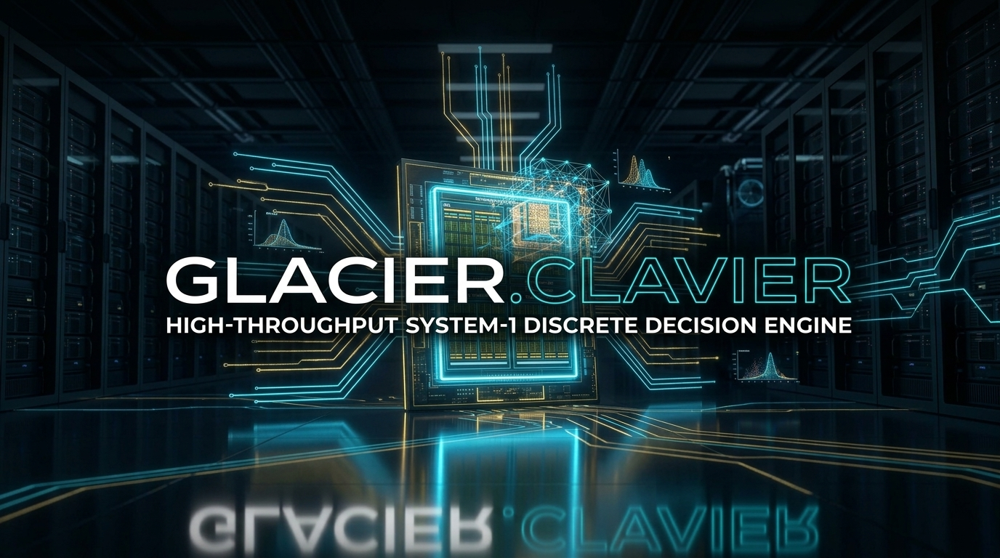

# Glacier.Clavier

[](https://github.com/ian-cowley/Glacier.Clavier/actions/workflows/publish-nuget.yml)
[](https://www.nuget.org/packages/Glacier.Clavier/)
[](LICENSE)


`Glacier.Clavier` is a C# System-1 decision and policy engine for .NET 10. It gives applications fast non-autoregressive classification (`Choice`), binary hypothesis verification (`Noul`), and bounded scalar scoring (`Score`)—along with online supervised updates, split conformal escalation gating, and binary checkpoint persistence.

---

## Install

```bash
dotnet add package Glacier.Clavier
```

Or build and test from source:

```bash
git clone https://github.com/ian-cowley/Glacier.Clavier.git
cd Glacier.Clavier
dotnet test Glacier.Clavier.slnx -c Release
```

---

## Quick Start

```csharp
using Glacier.Clavier.Engine;
using Glacier.Clavier.Model;

using var session = new ClavierSession(embeddingDim: 768, hiddenDim: 256, numActions: 8);

string[] actions = ["ENGAGE_TARGET", "RELOAD_WEAPON", "TAKE_COVER", "SCAN_PERIMETER"];
string state = "Hostile unit spotted at 15m. Primary Ammo empty (0/30).";

// 1. Discrete action selection, binary verification, and continuous rating
ClavierDecision decision = session.Decide(state.AsSpan(), actions);
ClavierNoul alert = session.Verify(state.AsSpan(), "Immediate reload required".AsSpan(), threshold: 0.5f);
ClavierScore urgency = session.Score(state.AsSpan(), "Combat urgency".AsSpan(), min: 0.0f, max: 100.0f);

// 2. Online supervised updates & .clvr checkpoint persistence
session.TrainDecision(state.AsSpan(), targetActionIndex: 1, actions, learningRate: 0.05f);
session.TrainVerify(state.AsSpan(), "Immediate reload required".AsSpan(), targetAffirmative: true);
session.TrainScore(state.AsSpan(), "Combat urgency".AsSpan(), targetValue: 92.0f, min: 0.0f, max: 100.0f);

using var fs = File.Create("policy.clvr");
session.SaveCheckpoint(fs);
fs.Position = 0;
session.LoadCheckpoint(fs);
```

---

## What You Can Do

- **Three Calibrated Decision Heads (`Choice`, `Noul`, `Score`):** Evaluate fixed slots or dynamic candidate texts, verify boolean assertions with probability $[0, 1]$, and score continuous metrics inside bounded `[min, max]` ranges.
- **Split Conformal System-1 / System-2 Gating (`DecideConformalSet`):** Calibrate holdout non-conformity quantiles (`CalibrateConformal`) to guarantee marginal coverage $1 - \alpha$; emit singletons for fast System-1 execution or escalate `EmptyPredictionSet` / `AmbiguousPredictionSet` to a downstream LLM.
- **Calibration Diagnostics (`ClavierCalibration`):** Measure Brier score, label-smoothed categorical cross-entropy, Expected Calibration Error (ECE), and empirical quantiles cleanly on `Span<float>`.
- **Single-Lock Concurrent Batches:** Dispatch batched evaluations (`DecideBatch`, `VerifyBatch`, `ScoreBatch`) under one reader lock over SIMD-accelerated 4-way FMA dot products (`SimdKernels`).

---

## Platform & Compatibility

- **Runtime:** .NET 10 (`net10.0`), Native AOT and trimmer compatible (`IsAotCompatible=true`, `EnableTrimAnalyzer=true`).
- **SIMD Acceleration:** Powered by `System.Numerics.Tensors` and 4-way unrolled FMA kernels (`SimdKernels`).
- **Cross-Platform:** Tested on Windows and Linux x64 in GitHub Actions CI.

---

## Documentation

- [User Manual](docs/manual.md) — `ClavierSession`, encoders, conformal prediction sets, calibration helpers, and `.clvr` checkpoints
- [Architecture](docs/architecture.md) — 8-byte blittable structs, reader-writer lock concurrency, SIMD FMA kernels, and conformal math
- [Changelog](CHANGELOG.md) — Version history (`v1.2.1`)

---

## License & Credits

Licensed under the [MIT License](LICENSE).

Developed by Ian Cowley, Antigravity (Google DeepMind) and Claude.
