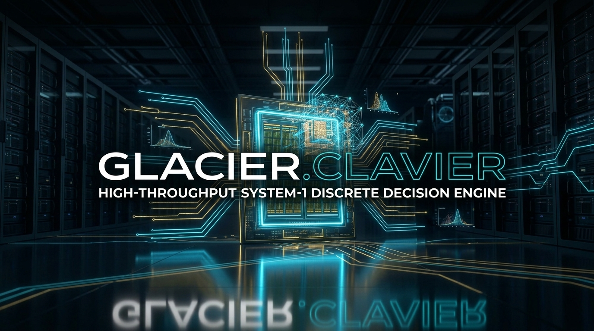

# ⚡ Glacier.Clavier

[](LICENSE)
[](https://dotnet.microsoft.com/)
[](https://learn.microsoft.com/dotnet/core/deploying/native-aot/)
[](https://www.nuget.org/packages/Glacier.Clavier/)
[](https://github.com/ian-cowley)
[](https://github.com/ian-cowley/Glacier.Clavier/actions/workflows/publish-nuget.yml)
[]()
[](https://glaciersoftware.dev/)
[](https://buymeacoffee.com/glaciersoftware)

> **High-Throughput Native C# .NET 10 System-1 Discrete Decision & Policy Engine**  
> *Non-autoregressive, calibrated decision primitives (`Choice`, `Noul`, `Score`), online supervised training, and binary checkpoint persistence executed in sub-millisecond forward passes.*

---

## 1. Overview: System-1 Calibrated Primitives

`Glacier.Clavier` provides strictly typed, mathematically calibrated System-1 decision heads with zero reflection (`System.Numerics.Tensors` SIMD accelerated):

1. **`Choice` (`Decide` / `DecideWithDistribution` / `TrainDecision`)**: Evaluates either fixed discrete action slots (`0..K-1`) or dynamic text candidate actions (jointly encoding `(state, candidateAction[i])` so action semantics directly determine logits regardless of list ordering) and emits a calibrated softmax probability distribution.
2. **`Noul` (`Verify` / `VerifyWithDetails` / `TrainVerify`)**: Evaluates an assertion or hypothesis against state, outputting an affirmative/negative verdict with calibrated probability $p \in [0, 1]$.
3. **`Score` (`Score` / `ScoreWithDetails` / `TrainScore`)**: Rates state against continuous criteria on a bounded scale $[\text{min}, \text{max}]$ with an epistemic certainty score.

---

## 2. Quickstart in C#

### 2.1 Inference (`Choice`, `Noul`, `Score`)
```csharp
using Glacier.Clavier.Engine;
using Glacier.Clavier.Model;

using var session = new ClavierSession(embeddingDim: 768, hiddenDim: 256, numActions: 8);

string[] actions = ["ENGAGE_TARGET", "RELOAD_WEAPON", "TAKE_COVER", "SCAN_PERIMETER"];
string state = "Hostile unit spotted at 15m. Primary Ammo empty (0/30).";

// 1. Choice (Discrete Action Selection)
ClavierDecision decision = session.Decide(state.AsSpan(), actions);

// 2. Noul (Binary Hypothesis Verification)
ClavierNoul alert = session.Verify(state.AsSpan(), "Immediate reload required".AsSpan(), threshold: 0.5f);

// 3. Score (Bounded Continuous Rating)
ClavierScore urgency = session.Score(state.AsSpan(), "Combat urgency".AsSpan(), min: 0.0f, max: 100.0f);
```

### 2.2 Online Supervised Training & Binary Checkpoints (`v1.1.0`)
```csharp
// Supervised gradient updates across all 3 heads
float choiceLoss = session.TrainDecision(state.AsSpan(), targetActionIndex: 1, actions, learningRate: 0.05f);
float noulLoss   = session.TrainVerify(state.AsSpan(), "Immediate reload required".AsSpan(), targetAffirmative: true);
float scoreLoss  = session.TrainScore(state.AsSpan(), "Combat urgency".AsSpan(), targetValue: 92.0f, min: 0.0f, max: 100.0f);

// Persist and reload calibrated weights
using var fs = File.Create("policy.clvr");
session.SaveCheckpoint(fs);

fs.Position = 0;
session.LoadCheckpoint(fs);
```

---

## 3. Blittable 8-Byte Structs & Lock-Free Batching

All three primitives emit 8-byte blittable structs (`Marshal.SizeOf<T>() == 8`) with lock-free concurrent forward execution across `DecideBatch`, `VerifyBatch`, and `ScoreBatch`:

```csharp
[StructLayout(LayoutKind.Sequential, Pack = 4)]
public readonly struct ClavierDecision // uint ActionId (4B) + float Confidence (4B)

[StructLayout(LayoutKind.Sequential)]
public readonly struct ClavierNoul     // float Probability (4B) + byte Affirmative (1B + 3B natural align)

[StructLayout(LayoutKind.Sequential)]
public readonly struct ClavierScore    // float Value (4B) + float Confidence (4B)
```

---

## 4. Verification

```bash
dotnet build Glacier.Clavier.slnx -c Release
dotnet test Glacier.Clavier.slnx -c Release
python scripts/security_check.py Glacier.Clavier
```

---

## Credits & License

Developed by **Ian Cowley** and **Antigravity (Google DeepMind)**. Licensed under the [MIT License](LICENSE).
