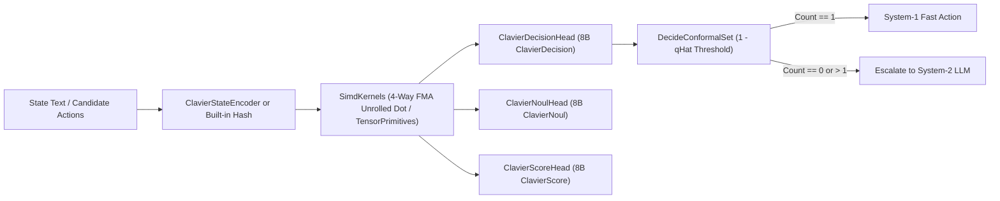

# Glacier.Clavier Architecture

`Glacier.Clavier` compiles lightweight System-1 neural heads and conformal uncertainty estimation into zero-reflection Native AOT structs and reader-writer locked sessions.

---

## Forward & Escalation Pipeline

---

## Key Design Decisions

1. **8-Byte Blittable Return Structs:**
   - `ClavierDecision` (`uint ActionId`, `float Confidence`), `ClavierNoul` (`float Probability`, `byte Affirmative`), and `ClavierScore` (`float Value`, `float Confidence`) each occupy `8` bytes (`[StructLayout(LayoutKind.Sequential)]`), allowing zero-GC-allocation return paths and compact batch arrays.
2. **Thread Safety & Single-Lock Batching (`ClavierSession`):**
   - Forward methods acquire `_rwLock.EnterReadLock()`, allowing unbounded parallel inference threads, while `Train*`, `Temperature`, `ConformalQuantile`, `CalibrateConformal`, and `LoadCheckpoint` serialize safely under `_rwLock.EnterWriteLock()`.
   - Batch inference acquires the read lock once per batch rather than locking per sample.
3. **4-Way FMA SIMD Kernels (`SimdKernels`):**
   - Breaks loop-carried FMA accumulation dependencies across 4 independent vector accumulators paired with `System.Numerics.Tensors.TensorPrimitives`.
4. **Finite-Sample Conformal Safety (`ClavierCalibration.CalibrateQuantile`):**
   - Computes $k = \lceil (n + 1)(1 - \alpha) \rceil$; when calibration set size $n$ is too small for $\alpha$ ($k > n$), returns $\hat{q} = 1.0$, forcing conservative escalation rather than emitting under-covered singleton predictions.
